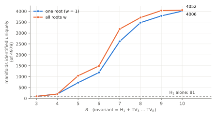
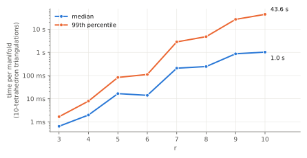

## Summary

We computed $H_1$, Regina's simplified $\pi_1$ presentation, and the exact
Turaev–Viro invariants $TV_r$ for $3 \le r \le 10$ at every admissible root
of unity. We did this for all 14,720 triangulations in Regina's closed
orientable census, which covers 4,979 prime manifolds with at most 10
tetrahedra.

* **All roots vs. one root.** For a fixed $r$ and parity, the values at the
  different roots are Galois conjugates of one exact value. So once $w = 1$
  is known they add nothing, and the data confirm this. Extra information
  comes only from the **other parity** ($q_0$ a primitive $r$-th root of
  unity, for odd $r$). With it, $H_1 + TV_{3..10}$ identifies **4,052**
  manifolds uniquely, against **4,006** using $w = 1$ alone. It splits the
  census into **4,304** classes instead of 4,273.
* **When the parity matters.** The two parities disagreed only on manifolds
  with $H_1(M;\mathbb{Z}_2) \ne 0$: 1,187 of the 2,904 such manifolds, and
  none of the 2,075 others.
* **What survives.** 927 manifolds in 252 groups are not separated. 229
  groups consist only of lens spaces. Of the lens-space pairs inside those
  groups, 577 are **not even homotopy equivalent**. The other 23 groups
  contain Seifert fibred spaces. Eight of them put a lens space together
  with a Seifert fibred space whose $\pi_1$ is infinite.
* **Cost.** The run took 8.1 CPU-hours. It is dominated by $TV_9$ and
  $TV_{10}$, which have a heavy tail: on 10-tetrahedron triangulations
  $TV_{10}$ has a median of 1.0 s and a maximum of 182 s.
* **Sanity checks.** No triangulation disagreed with another triangulation
  of the same manifold (9,741 rechecked). The census names of the 1,086
  lens spaces are pairwise non-homeomorphic.

## Background

### Turaev–Viro invariants and roots of unity

$TV_r(M)$ is a state sum over colourings of the edges of a triangulation. It
depends on an integer $r \ge 3$ and a root of unity
$q_0 = e^{i\pi w / r}$ with $\gcd(w, r) = 1$. We call $w$ the **root**, as
Regina's `turaevViroApprox(r, w)` does. Two values of $w$ give the same
invariant up to Galois conjugation exactly when they have the same parity:

* odd $w$: $q_0$ is a primitive $2r$-th root of unity, and the exact value
  lies in $\mathbb{Q}(\zeta_{2r})$ (Regina: `turaevViro(r, True)`);
* even $w$, only possible for odd $r$: $q_0$ is a primitive $r$-th root of
  unity, and the value lies in $\mathbb{Q}(\zeta_r)$ (Regina:
  `turaevViro(r, False)`).

The roots $w$ and $2r - w$ are complex conjugate, and $TV_r$ is real, so
they give the same value. Up to conjugation there are $\varphi(2r)/2$ odd
roots for each $r$, and for odd $r$ also $\varphi(r)/2$ even roots.

**Why one root per parity is enough.** Evaluating at a single primitive root
is a field embedding $\mathbb{Q}(\zeta_n) \hookrightarrow \mathbb{C}$, so it is
injective. Hence two manifolds have equal exact $TV_r$ if and only if they
agree at $w = 1$, and then they agree at every root of that parity. Regina's
documentation says the same ("switching between different roots of unity
does not yield new information"). Only the second parity can separate more.

### Notes on Regina's API

* `turaevViroApprox(r, w)` for even $w$ agrees with
  `turaevViro(r, False).evaluate(w/2)`. Regina's documentation says
  `evaluate(w)`, but that gives the value at a different root. This makes
  sense because the field for even $w$ has order $r$:
  $q_0 = e^{2\pi i (w/2)/r}$. `tests/test_e01.py` checks the mapping
  numerically.
* Computing exactly in the cyclotomic field is roughly $10^2$–$10^3$ times
  slower than `turaevViroApprox` at a single root. In exchange it gives
  every root at once and never needs a floating-point tolerance to compare
  values.

## Method

**Data.** We used Regina's `closed-or-census.rga`: closed orientable prime
minimal triangulations with $\le 10$ tetrahedra. That is 14,720
triangulations of 4,979 manifolds. The 11-tetrahedron census (`.tdb`) is
only a lookup table keyed by isomorphism signature, so it cannot be
iterated.

**Invariants.** For every triangulation we recorded:
`homology()`; `fundamentalGroup()` (the number of generators and relations,
and `recogniseGroup()`); and the exact `turaevViro(r, parity)` for
$r = 3..6$ and both parities. For the first triangulation of each manifold
(the *representative*) we also computed $r = 7..10$. Each exact value was
evaluated at every root $w$, up to conjugation.

**Comparisons.** We grouped the 4,979 representatives by each invariant and
counted the classes and the singletons (manifolds identified uniquely):

* *$w = 1$*: the value at a single root, rounded to $10^{-9}$. This is what
  the earlier version of E01 used.
* *all odd $w$*: the exact value for `parity=True`.
* *all $w$*: both parities.

**Execution.** We used 4 worker processes and the code at git `a3adb6b` (the
same `run.py` as committed in `b62487a`). The first session hit a 2-hour
time limit after 14,685 records. The remaining 35 records were computed by
`run.py --resume` in 5.3 min. Total compute was 8.1 CPU-hours.

## Results

### Sanity checks

* **Consistency across triangulations.** All 9,741 non-representative
  triangulations were rechecked against their representative, comparing
  $H_1$ and the exact $TV_r$ for $r \le 6$. There were no disagreements.
* **Lens-space names.** No two of the 1,086 lens-space names in the census
  are homeomorphic under the classification
  $L(p,q) \cong L(p,q') \iff q' \equiv \pm q^{\pm 1} \pmod p$.

### Single invariants

| invariant | classes | identified uniquely | largest class |
|-----------|--------:|--------------------:|--------------:|
| $H_1$ | 446 | 81 | 45 |
| $TV_5$, $w = 1$ (= all odd $w$) | 128 | 35 | 1,324 |
| $TV_5$, all $w$ | 193 | 47 | 536 |
| $TV_7$, $w = 1$ (= all odd $w$) | 407 | 183 | 1,313 |
| $TV_7$, all $w$ | 634 | 285 | 274 |
| $TV_8$ | 328 | 99 | 665 |
| $TV_9$, $w = 1$ (= all odd $w$) | 646 | 327 | 1,284 |
| $TV_9$, all $w$ | 951 | 505 | 219 |
| $TV_{10}$ | 521 | 233 | 536 |

The "$w = 1$" and "all odd $w$" rows agree for every $r$, as the Galois
argument predicts; `data/e01/report.txt` has every row. $TV_3$ alone has
only 6 classes (9 with both parities), and $TV_4$ has 35. Odd levels carry
more information than their even neighbours, mainly because only odd levels
have the second parity.

### Cumulative separation



| $R$ | $w = 1$: classes / unique | all $w$: classes / unique |
|----:|--------------------------:|--------------------------:|
| 3 | 480 / 94 | 480 / 94 |
| 4 | 724 / 198 | 724 / 198 |
| 5 | 1,556 / 720 | 1,895 / 1,038 |
| 6 | 2,054 / 1,188 | 2,289 / 1,488 |
| 7 | 3,339 / 2,617 | 3,748 / 3,184 |
| 8 | 3,948 / 3,478 | 4,095 / 3,712 |
| 9 | 4,140 / 3,789 | 4,294 / 4,033 |
| 10 | 4,273 / 4,006 | 4,304 / 4,052 |

The second parity helps most at small $R$. At $R = 5$ it identifies 44% more
manifolds uniquely (1,038 vs 720). By $R = 10$ the gap has narrowed to 46
manifolds.

**Which levels matter (drop-one).** We removed each $TV_r$ from the full set
$H_1 + TV_{3..10}$ (all $w$, 4,304 classes) and recounted:

| removed | $TV_3$ | $TV_4$ | $TV_5$ | $TV_6$ | $TV_7$ | $TV_8$ | $TV_9$ | $TV_{10}$ |
|---------|------:|------:|------:|------:|------:|------:|------:|---------:|
| classes left | 4,304 | 4,296 | 4,297 | 4,282 | 4,119 | 4,243 | 4,123 | 4,294 |

So $TV_3$ is implied by the other levels, and $TV_{10}$ adds only 10 classes.
$TV_7$ and $TV_9$ carry the most information that no other level supplies.
$H_1 + TV_{4..9}$ (all $w$) gives 4,294 classes and 4,033 unique manifolds.
The smaller set $H_1 + TV_{5,7,9}$ gives 4,092 classes and 3,727 unique.

### When the second parity matters

For odd $r$ we compared the multisets of values over the odd and the even
roots:

| $H_1(M;\mathbb{Z}_2)$ | manifolds | parities differ for some $r$ | for all $r \in \{3,5,7,9\}$ |
|-----------------------|----------:|-----------------------------:|----------------------------:|
| $= 0$ | 2,075 | 0 | 0 |
| $\ne 0$ | 2,904 | 1,187 | 1,087 |

The parities never disagreed on a manifold with $H_1(M;\mathbb{Z}_2) = 0$.
This fits the expectation that at odd $r$ the difference between $q_0$ and
$-q_0$ is controlled by $\mathbb{Z}_2$-cohomology. Nonzero
$H_1(M;\mathbb{Z}_2)$ is necessary for a difference but not sufficient:
1,717 such manifolds, including $L(4,1)$, showed none. Characterising
exactly when the parities differ is an open question for a follow-up.

### What $H_1 + TV_{3..10}$ cannot separate

927 manifolds in 252 groups survive every invariant computed here. Group
sizes range from 2 (104 groups) to 11; the full list is in
`data/e01/survivors.tsv`.

**Lens spaces (229 groups).** Within each group all spaces share $p$. Of
the 1,728 pairs inside these groups:

* 1,151 pairs are homotopy equivalent ($qq' \equiv \pm n^2 \pmod p$) but
  not homeomorphic;
* **577 pairs are not even homotopy equivalent.** So $TV_{3..10}$ fails to
  separate some homotopy types of lens spaces, not just homeomorphism types.

The largest groups have 11 members, one with $p = 127$ and one with $p = 89$.

**Groups with Seifert fibred spaces (23 groups).**

* 8 groups put lens spaces together with a Seifert fibred space
  $\mathrm{SFS}[S^2: (a_1,b_1)(a_2,b_2)(a_3,b_3)]$ with the same $H_1$.
  Examples: $L(55,16)$, $L(55,19)$, $L(55,21)$ and
  $\mathrm{SFS}[S^2:(3,2)(7,2)(8,-5)]$; or $L(36,17)$ and two SFS with
  fibres $(2,3,6)$. In every case $\tfrac1{a_1}+\tfrac1{a_2}+\tfrac1{a_3} \le 1$.
  So the SFS has infinite $\pi_1$, and $\pi_1$ (finite vs. infinite)
  separates it from the lens spaces. Turaev–Viro invariants up to $r = 10$
  do not.
* 15 groups contain only Seifert fibred spaces, e.g.
  $\mathrm{SFS}[S^2:(3,1)(3,1)(3,1)]$ and $\mathrm{SFS}[S^2:(3,2)(3,2)(3,-1)]$.
  These have the same rational Euler number but different Seifert
  invariants, so they are distinct manifolds.

`recogniseGroup()` is not a reliable separator. It named $\pi_1$ for only 603
of the 1,086 lens spaces, depending on how the presentation simplified, and
it returned nothing for most SFS. Unrecognised groups are therefore lumped
together in the tables.

### Cost



| on 10-tetrahedron triangulations | $TV_5$ | $TV_7$ | $TV_8$ | $TV_9$ | $TV_{10}$ |
|---|---:|---:|---:|---:|---:|
| median | 17 ms | 0.21 s | 0.25 s | 0.87 s | 1.0 s |
| 99th percentile | 83 ms | 2.8 s | 4.8 s | 27 s | 44 s |
| maximum | 0.26 s | 10 s | 19 s | 105 s | 182 s |

$H_1$ and $\pi_1$ take under 1 ms. The slowest manifolds at every level $r \ge 7$
were torus bundles: $T \times I / [-7,-3 \mid -2,-1]$ (182 s for $TV_{10}$),
and $T \times I / [7,3 \mid 2,1]$ for $TV_9$.
The tail, not the median, determines total run time. E10 will relate it to
treewidth.

## Conclusions

1. **Use both parities and ignore the other roots.** The other roots of the
   same parity are redundant by Galois theory, and the data confirm it. The
   second parity at odd $r$ is cheap (about 2× one parity) and identifies
   up to 44% more manifolds.
2. **Recommended cheap set for census-scale comparisons:**
   $H_1 + TV_{4..9}$, both parities. It reaches 4,294 of the 4,304 classes
   that $TV_{3..10}$ gives, and skips $TV_{10}$, the most expensive level.
3. **Lens spaces need a different invariant.** Turaev–Viro invariants up to
   $r = 10$ leave 577 non-homotopy-equivalent lens-space pairs together.
   Reidemeister torsion classifies lens spaces up to homeomorphism, and the
   linking form of $H_1$ classifies them up to homotopy. Neither is computed
   here.
4. **Finiteness of $\pi_1$ resolves the 8 mixed lens/SFS groups.**

## Next steps

* Investigate when the two parities differ beyond the condition
  $H_1(M;\mathbb{Z}_2) \ne 0$ (e.g. the linking form on 2-torsion).
* Add invariants that separate lens spaces: the linking form of $H_1$, and
  Reidemeister torsion via an external tool. Rerun the survivor analysis.
* Feed the 15 SFS-only groups to Regina's Seifert-invariant recognition, to
  confirm they are genuinely distinct, and record which invariant first
  separates them.
* Larger $r$ ($TV_{11}$, $TV_{12}$) only for the 252 survivor groups. They
  are small enough that the cost at large $r$ is affordable.

## Reproduce

```sh
make e01 ARGS="--r-max 10"            # ~2 h on 4 cores; add --resume RUN_DIR if interrupted
make e01-export ARGS="results/e01_closed_census_invariants/<run>"   # data/e01 + figures
make writeups                         # rebuild this PDF
```

Curated outputs are under `data/e01/`:

* `summary.json`: every table in this writeup;
* `survivors.tsv`: the unseparated groups;
* `report.txt`: the full analysis output.
