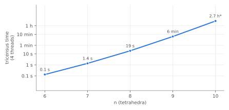

## Summary

We ran Regina's census generator `tricensus` from scratch for every size
$n \le 10$ tetrahedra. It produced 66,439 closed orientable triangulations,
and we classified each one.

* **The shipped census is reproduced exactly.** All 14,720 triangulations in
  Regina's closed orientable census are generated, and none are missing.
  Each of the other 51,719 generated triangulations was **certified**
  non-minimal or non-prime by explicit simplification. Nothing was left
  unresolved.
* **One greedy `simplify()` call settles 97.1% of the non-minimal
  triangulations.** The remaining 1,494 need `simplifyExhaustive` (which
  searches through moves that temporarily add tetrahedra) at height 1 (567
  triangulations), 2 (926) or 3 (1). Four more are
  3-spheres or connected sums, which are certified directly; these also
  need height 2 to simplify.
* **`simplify()` is randomised, and the hard cases are consistent.** Over
  50 independent calls on every non-minimal triangulation, one call fails
  with probability 2.7% at $n = 10$; at $n = 6$ it was 5.9%. Every
  triangulation that needs height $\ge 2$ was never reduced in 50 calls.
  The deterministic part, `simplifyToLocalMinimum()`, reduced none of them,
  because `tricensus -M` already removes everything it would catch.
* **Generation cost grows about 25× per tetrahedron.** $n = 10$ took 10.8
  thread-hours over 48,432 face pairings. The time per pairing is extremely
  skewed: 3 of 97 chunks took 62% of the total.

## Purpose

Later experiments (E03 scrambles and simplifies triangulations; E04 walks
between them) need a generator they can trust. They also need it for
spaces the shipped census does not cover: bounded, ideal and non-minimal
triangulations, and 4-manifolds. The cleanest test of that generator is to
rebuild a census we already have and check the result line by line.

## Method

**Generation.** For each $n$ we ran

```
tricensus -t n -i -f -o -M -s --threads 4
```

The options ask for: all faces glued (`-i`); no ideal vertices (`-f`);
orientable (`-o`); triangulations that are not *obviously* non-minimal or
non-prime (`-M`); and output as isomorphism signatures (`-s`). For $n = 10$
we first listed all face pairings (`tricensus -t 10 -i -p`), then processed
them in 97 chunks of 500 (`tricensus -P -f -o -M -s`), one thread per chunk,
four at a time. Each chunk was cached on disk. This was needed because the
first, unchunked attempt at $n = 10$ was lost to a container restart. At
$n = 7$ we checked that chunked and direct generation give identical
output.

**Classification.** Each generated triangulation is placed in the first
category that applies:

1. **census**: its isomorphism signature is in Regina's closed orientable
   census database (`Census.lookup`, restricted to that database);
2. **simplify**: one `simplify()` call brings it below $n$ tetrahedra;
3. **S3**: it is a 3-sphere (`isSphere()`); the 3-sphere has a
   1-tetrahedron triangulation, so this one is not minimal;
4. **nonprime**: `summands()` returns at least 2 pieces;
5. **exhaustive:h**: `simplifyExhaustive(h)` reduces it, for the smallest
   $h \le 3$. The search may pass through triangulations with up to $n + h$
   tetrahedra;
6. **unresolved**: none of the above.

We also recorded every census triangulation of size $n$ that `tricensus`
did not produce (**missing**).

**Reliability of `simplify()` (E02b).** `simplify()` uses random 4-4 moves,
so "reduced by one call" is a single random sample. For all 51,719
non-minimal triangulations, `retry.py` makes 50 independent `simplify()`
calls and counts the successes. It also tries the deterministic
`simplifyToLocalMinimum()` once.

**What this checks, and what it doesn't.** It checks two things
independently of the shipped data: that generation covers the census, and
that every extra triangulation is non-minimal. It does not re-prove that
the census triangulations are themselves minimal, or that the census names
identify the manifolds correctly; both rest on the original census
computation.

## Results

### The census is reproduced exactly

| $n$ | pairings | generated | in census | simplify | exh. 1 | exh. 2 | exh. 3 | S³ | non-prime | missing | unresolved |
|---:|---:|---:|---:|---:|---:|---:|---:|---:|---:|---:|---:|
| 1 | 1 | 4 | 4 | 0 | 0 | 0 | 0 | 0 | 0 | 0 | 0 |
| 2 | 2 | 11 | 10 | 1 | 0 | 0 | 0 | 0 | 0 | 0 | 0 |
| 3 | 4 | 7 | 7 | 0 | 0 | 0 | 0 | 0 | 0 | 0 | 0 |
| 4 | 10 | 17 | 15 | 2 | 0 | 0 | 0 | 0 | 0 | 0 | 0 |
| 5 | 28 | 50 | 40 | 9 | 0 | 1 | 0 | 0 | 0 | 0 | 0 |
| 6 | 97 | 168 | 115 | 50 | 0 | 3 | 0 | 0 | 0 | 0 | 0 |
| 7 | 359 | 564 | 309 | 241 | 3 | 11 | 0 | 0 | 0 | 0 | 0 |
| 8 | 1,635 | 2,380 | 945 | 1,378 | 15 | 42 | 0 | 0 | 0 | 0 | 0 |
| 9 | 8,296 | 10,763 | 3,031 | 7,461 | 88 | 182 | 0 | 1 | 0 | 0 | 0 |
| 10 | 48,432 | 52,475 | 10,244 | 41,079 | 461 | 687 | 1 | 1 | 2 | 0 | 0 |
| **total** | | **66,439** | **14,720** | **50,221** | **567** | **926** | **1** | **2** | **2** | **0** | **0** |

The "in census" column equals the size of the shipped census at every $n$.
No census triangulation is missing and nothing is unresolved.


As $n$ grows, a shrinking share of the output is minimal: 80% at $n = 5$,
40% at $n = 8$, 19.5% at $n = 10$. Generated triangulations grew 4.9×
from $n = 9$ to $n = 10$, while the census grew 3.4×.

### The hardest cases

Four triangulations fall outside the "simplify" and "exhaustive"
categories. We ran `simplifyExhaustive` on each of them separately:

* **Two non-minimal 3-spheres** (sizes 9 and 10). `simplify()` never
  reduced them in 50 calls. `simplifyExhaustive(2)` reduces each to the
  1-tetrahedron triangulation.
* **Two non-prime triangulations** ($n = 10$). Each is
  $L(5,1) \# L(5,1)$, and each needs height 2.

The only triangulation that needs **height 3** ($n = 10$, signature
`kLLzLQAkaceiggghijjjkxuaatlsqw`) is a graph manifold. Its minimal census
triangulation, which it simplifies to, has 9 tetrahedra:

$\mathrm{SFS}[D:(2,1)(3,1)] \cup_m \mathrm{SFS}[D:(3,2)(3,2)]$,
$m = \left[\begin{smallmatrix}-1 & 1\\ 1 & 0\end{smallmatrix}\right]$.

All 1,494 triangulations that needed exhaustive search are in
`data/e02/hard_nonminimal.tsv`. Each row gives the height needed and the
`simplify()` success rate. They are a ready-made benchmark for E03.

### How reliable is one `simplify()` call?

| $n$ | non-minimal | reduced by `simplifyToLocalMinimum()` | `simplify()` always works (50/50) | sometimes | never (0/50) | P(one call fails) |
|---:|---:|---:|---:|---:|---:|---:|
| 5 | 10 | 0 | 9 | 0 | 1 | 10.0% |
| 6 | 53 | 0 | 46 | 4 | 3 | 5.9% |
| 7 | 255 | 0 | 231 | 13 | 11 | 4.8% |
| 8 | 1,435 | 0 | 1,285 | 103 | 47 | 4.1% |
| 9 | 7,732 | 0 | 7,055 | 466 | 211 | 3.5% |
| 10 | 42,231 | 0 | 39,095 | 2,327 | 809 | 2.7% |

($n = 2$ and $n = 4$ have one and two non-minimal triangulations
respectively; `simplify()` always reduced them.)

Three observations:

* **The local moves reduce nothing.** `simplifyToLocalMinimum()` uses only
  moves that never increase the number of tetrahedra. It reduced none of
  the 51,719 triangulations. That is expected: `tricensus -M` already
  discards triangulations with the low-degree edges those moves would
  remove. Every successful `simplify()` therefore came from its random
  4-4 moves (and book moves).
* **Height 2 means `simplify()` never succeeds.** All 1,082 triangulations
  that were never reduced in 50 calls are among the 1,498 hard cases: the
  1,494 that needed exhaustive search plus the four 3-sphere and non-prime
  cases. They are: all 926 at height 2, the one at height 3,
  the four 3-sphere and non-prime cases (also height 2), and 151 of the
  567 at height 1. The other 416 height-1 cases are reduced by
  `simplify()` sometimes. The mean success rate over all 1,494 hard
  triangulations is 20%. Every triangulation that a single call had
  reduced in the main run was reduced again in at least one of the 50
  retries.
* **Bigger triangulations are easier, in this sense.** The per-call
  failure rate falls with $n$: 5.9% at $n = 6$, 2.7% at $n = 10$. One
  plausible reason is that larger triangulations have more 4-4 moves
  available, giving the random walk more ways out of a local minimum.

### Cost



| | $n = 7$ | $n = 8$ | $n = 9$ | $n = 10$ |
|---|---:|---:|---:|---:|
| tricensus time (4 threads) | 1.4 s | 19 s | 6.4 min | 2.7 h (10.8 thread-h) |
| growth from $n - 1$ | ×10 | ×14 | ×20 | ×26 |

The growth factor itself increases with $n$. At ×30 for $n = 11$, a rerun
would need roughly 300+ thread-hours, so the shipped 11-tetrahedron lookup
table is the practical source at that size.

**Time per face pairing is extremely skewed.** For the 97 chunks at
$n = 10$ (500 pairings each), the median chunk took 0.2 s and the 90th
percentile 14 min. The slowest took 3.1 h and produced only 729
triangulations. The three slowest chunks account for 62% of all thread
time. A finer split, or ordering pairings by expected cost, would cut the
wall-clock time substantially.

Classification is cheap by comparison. At $n = 10$, lookup takes about
2.5 ms per triangulation and `simplify()` 0.15 ms. When it is needed,
`simplifyExhaustive` takes 5 ms on average at height 1 (37 ms at most),
33 ms at height 2 (186 ms at most), and 0.39 s for the single height-3
case. Exhaustive search is affordable at this size, but grows quickly with
height.

## Conclusions

1. **`tricensus` plus Regina's simplification is a reliable census
   pipeline.** It reproduces the closed orientable census exactly up to
   $n = 10$. Every non-census triangulation is certified non-minimal or
   non-prime, with no exceptions. We can use it with confidence for the
   bounded, ideal and 4-dimensional censuses in later experiments.
2. **Minimality checks need more than one `simplify()` call.** About 2.7%
   of non-minimal 10-tetrahedron triangulations defeat a single call.
   Those needing height $\ge 2$ defeat it every time. A pipeline that
   declares "minimal" after one `simplify()` would be wrong on about 1 in
   40 triangulations at this size. Repeated calls help only at height 1;
   beyond that, `simplifyExhaustive` is needed.
3. **E03 has a benchmark set.** `data/e02/hard_nonminimal.tsv` lists 1,494
   naturally occurring hard non-minimal triangulations, including 3-spheres
   that need height 2.

## Next steps

* E03: use the hard set to compare `simplify()`, `simplifyExhaustive` at
  each height, and random up-down strategies.
* Speed up chunked generation by ordering face pairings by expected cost,
  or by splitting the heaviest pairings further.
* Extend the same pipeline to bounded and ideal censuses (`-b`, `-d`, `-h`)
  and to 4-manifolds (`--dim4`, E09).

## Reproduce

```sh
make e02 ARGS="--max-n 10"   # n=10 is chunked and resumable: add --resume RUN_DIR
make e02-retry ARGS=results/e02_tricensus_regeneration/<run>
make e02-export ARGS=results/e02_tricensus_regeneration/<run>
make writeups
```

Curated outputs are in `data/e02/`: `summary.json`, `report.txt` and
`hard_nonminimal.tsv`. The full run directory is
`results/e02_tricensus_regeneration/20261020T084518Z`. Its first session
generated $n \le 9$ (git `21e61de`). The resumed session generated
$n = 10$ in chunks. Its recorded commit, `b4183f3-dirty`, contained the
chunking code that was committed unchanged as `9876624`.
