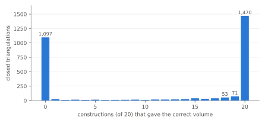

## Summary

We examined all 13,853 ideal triangulations in Regina's cusped hyperbolic
censuses (6,074 manifolds, up to 7 tetrahedra). For each we tested for a
strict angle structure and asked SnapPea for a hyperbolic structure. We also
checked all 3,018 triangulations in the Hodgson–Weeks closed census.

* **Theory and computation agree.** No triangulation is geometric without a
  strict angle structure; this must hold, because a geometric solution
  *is* a strict angle structure. Linear programming and full enumeration
  agree on which triangulations have a strict angle structure, in all
  13,853 cases.
* **97.8% of census triangulations are geometric, and every manifold has a
  geometric one.** The 300 that are not split into two kinds. 266 have a
  strict angle structure, but SnapPea's solution is not geometric; this is
  the case Casson–Rivin theory allows when volume is maximised on the
  boundary. 34 have no strict angle structure at all. The first census
  triangulation (`#1`) of every manifold is geometric.
* **Only one-cusped triangulations fail.** All 183 non-geometric
  orientable triangulations, and 116 of the 117 non-orientable ones, have a
  single cusp. Triangulations with 2–4 cusps are almost always geometric.
* **Volumes are fully consistent:**
  * different triangulations of the same manifold agree to $1.7 \times 10^{-14}$,
    even when SnapPea's solution is not geometric;
  * within each census prefix, the names are in non-decreasing volume order;
  * volume $\le n \cdot v_\mathrm{tet}$, with equality exactly for the
    triangulations made of regular ideal tetrahedra.
* **SnapPea on a closed triangulation is unreliable and random.** Regina
  passes the triangulation to SnapPea, which turns it into a filling of a
  cusped manifold it builds itself, and this conversion is randomised.
  Across 20 independent attempts:
  * one attempt gets the right volume 58% of the time;
  * 1,470 triangulations always work and 1,097 (36%) never do;
  * every non-degenerate solution has the right volume.

  Rebuilding each closed manifold as the Dehn filling named in its census
  label reproduces **all 3,018** labelled volumes.
* **Regina's cusped census triangulations are often the mirror image of
  SnapPy's manifold with the same name.** For each base manifold, the
  labelled filling slopes work either as given (328 bases) or with
  $(p,q) \mapsto (-p,q)$ (278 bases); never with some of each. 37 bases
  accept both conventions; 4 need a different change of peripheral basis.

## Background

An **angle structure** on an ideal triangulation assigns a dihedral angle in
$[0,\pi]$ to each pair of opposite edges of every tetrahedron. The three
angles at each vertex of a tetrahedron sum to $\pi$, and the angles around
each edge of the triangulation sum to $2\pi$.

* It is **strict** if every angle is in $(0,\pi)$.
* It is **taut** if every angle is $0$ or $\pi$.

A **geometric** solution of the hyperbolic gluing equations (SnapPea
`Solution.Geometric`) has every tetrahedron positively oriented. The
arguments of its shape parameters then form a strict angle structure, so

$$\text{geometric} \;\Longrightarrow\; \text{strict angle structure}.$$

The converse fails in general. Casson and Rivin showed that if a strict
angle structure exists and the volume functional attains its maximum in the
interior of the space of strict angle structures, then the maximiser is the
complete hyperbolic structure. When the maximum lies on the boundary, the
triangulation is not geometric, even though the manifold may still be
hyperbolic. SnapPea then reports `Nongeometric` (some tetrahedra negatively
oriented) or `Degenerate` (some tetrahedra flat).

## Method

**Data.** Regina 7.4.1 ships these hyperbolic censuses:

| census (Regina file) | triangulations | manifolds | tetrahedra | cusps |
|---|---:|---:|---:|---|
| `cusped-hyp-or` (orientable) | 9,596 | 4,815 | 2–7 | 1–3 |
| `cusped-hyp-nor` (non-orientable) | 4,257 | 1,259 | 1–7 | 1–4 |
| `closed-hyp` (Hodgson–Weeks) | 3,018 | — | 9–29 | closed |

The `.tdb` lookup databases go further (9 tetrahedra), but the iterable
`.rga` files stop at 7. Manifold names follow SnapPea's census (`m`, `s`,
`v` for orientable and `m`, `x`, `y` for non-orientable). The two censuses
never use the same name. Each closed-census label has the form
`<volume> : <cusped manifold>(p, q)`. 18 of the closed manifolds are
non-orientable, and they are fillings of non-orientable cusped manifolds.

**For each cusped triangulation** (`run.py`):

* `hasStrictAngleStructure()`, which uses linear programming;
* `AngleStructures(t)`, which enumerates every vertex of the
  angle-structure polytope, together with `spansStrict()` and
  `spansTaut()`;
* `SnapPeaTriangulation(t)`: the solution type, the volume and its
  estimated precision, and the smallest imaginary part of any shape.

**For each closed triangulation:**

* `SnapPeaTriangulation(t)` 20 times independently, because the result
  varies between constructions. The cusped triangulations do not vary: 80
  sampled ones never changed over 10 constructions each.
* The Dehn filling named in the label, applied to the first census
  triangulation of the base manifold. It is computed both as given and with
  $(p,q) \mapsto (-p,q)$, each on a fresh SnapPea object. Filling the same
  object repeatedly is path-dependent: SnapPea starts each solve from the
  previous solution and can end up degenerate.
* For the 4 bases where neither convention works: a search over all
  $2\times 2$ integer matrices with entries in $[-3,3]$ and determinant $\pm 1$.

The whole run takes 37 s on 4 cores. All numbers are from run
`20261029T200717Z`. Closed-triangulation counts vary by a few between runs,
because SnapPea's conversion is random.

## Results: cusped censuses

### Angle structures vs geometry

| | orientable | non-orientable |
|---|---:|---:|
| strict angle structure, geometric | 9,413 | 4,140 |
| strict angle structure, **not** geometric | 164 | 102 |
| no strict angle structure (never geometric) | 19 | 15 |
| *geometric without a strict angle structure* | **0** | **0** |
| LP vs enumeration disagreements | 0 | 0 |
| has a taut angle structure | 9,569 | 4,230 |

**By size** (orientable; non-orientable in `data/e06/report.txt`):

| $n$ | triangulations | geometric | strict, not geometric | no strict | mean vertices of the angle polytope |
|---:|---:|---:|---:|---:|---:|
| 2 | 2 | 2 | 0 | 0 | 5.0 |
| 3 | 10 | 10 | 0 | 0 | 8.6 |
| 4 | 75 | 75 | 0 | 0 | 15.4 |
| 5 | 360 | 359 | 1 | 0 | 27.7 |
| 6 | 1,736 | 1,710 | 23 | 3 | 55.0 |
| 7 | 7,413 | 7,257 | 140 | 16 | 112.5 |

The first non-geometric triangulation appears at 5 tetrahedra (5 for the
non-orientable census too). The non-geometric share then grows to 2.1% at
$n = 7$. The angle polytope roughly doubles its number of vertices with
each tetrahedron.

**The failures are concentrated:**

* **Every manifold has a geometric triangulation in the census.** In fact,
  `#1` is geometric for every manifold. The non-geometric triangulations
  are always additional triangulations of a manifold the census already
  triangulates geometrically. `data/e06/nongeometric.tsv` lists each one,
  with a geometric triangulation of the same manifold.
* **They are one-cusped.** All 183 orientable and 116 of 117
  non-orientable non-geometric triangulations have exactly one cusp. None
  of the 561 orientable triangulations with 2–3 cusps is non-geometric.
* **Almost all are taut.** 298 of the 300 non-geometric triangulations
  still have a taut angle structure. Overall only 54 of the 13,853
  triangulations have no taut angle structure.

### Volumes


Four independent consistency checks all pass:

1. **Topological invariance.** All triangulations of a manifold give the
   same volume to within $1.7\times 10^{-14}$. This includes non-geometric
   ones, where SnapPea's solution, though not geometric, still has the
   correct volume.
2. **Census order.** Within each name prefix (`m`, `s`, `v`; `m`, `x`, `y`),
   volume never decreases from one name to the next, matching the order of
   SnapPea's census.
3. **The bound $\mathrm{vol} \le n \cdot v_\mathrm{tet}$** holds everywhere.
   Equality, which requires every tetrahedron to be regular, is attained by
   16 orientable triangulations (e.g. `m003`, `m004`, `m202`, `s955`–`s961`,
   `v3551`) and 35 non-orientable ones (e.g. the Gieseking manifold `m000`
   with one tetrahedron).
4. **Known values.** `m003` and `m004` (the figure-eight knot complement)
   both have volume $2.0298832128\ldots = 2v_\mathrm{tet}$, as in E00.

## Results: closed census

### SnapPea on the closed triangulation

| solution type (first construction) | triangulations | volume = label |
|---|---:|---:|
| Geometric | 1,122 | 1,122 |
| Nongeometric | 643 | 643 |
| Degenerate | 1,253 | 0 |



Over 20 independent constructions per triangulation:

* **A non-degenerate solution always has the correct volume.** This held
  in every one of the 60,360 attempts. So the solution type is a reliable
  signal for whether the volume can be trusted.
* **The outcome is strongly bimodal.** 1,470 triangulations succeed every
  time, 1,097 never do, and only 451 are in between. One attempt succeeds
  58% of the time on average. Retrying helps only the 451 in-between
  triangulations.
* The success rate depends little on size: between 52% and 70% for every
  $n$ with at least 20 triangulations.

### Rebuilding the closed manifolds as Dehn fillings

Each label names a filling of a cusped census manifold, e.g.
`0.9427073627769277 : m003(-3, 1)` for the Weeks manifold. Applying it to
Regina's first triangulation of the base manifold:

| base manifolds | labelled volumes reproduced with slopes |
|---:|---|
| 328 | as given, $(p, q)$ |
| 278 | mirrored, $(-p, q)$ |
| 37 | either (includes the 18 non-orientable bases) |
| 4 | another basis change (below) |

Once each base's convention is applied, **all 3,018 labelled volumes are
reproduced**. Each base follows exactly one convention, with no exceptions.
This points to the bases themselves: Regina's census triangulation of the
base is often the *mirror image* of the manifold SnapPy uses for the same
name. Mirroring negates the meridian-longitude orientation. It is not a
mistake in either census, just a choice of orientation that Regina's
triangulations do not record.

The four exceptions:

* For `m010` (10 fillings), `s594` (13) and `s786` (6), the slopes that
  work are $(p,q) \mapsto (-p-q,\, q)$, up to an overall sign. This is a
  mirror image combined with a change of meridian, as if SnapPea's
  "shortest" peripheral basis had been chosen differently.
* `s960` has a single filling, which several basis changes fit.

## Cost

Per cusped triangulation, on average:

* linear programming for a strict angle structure: **0.16 ms**;
* full vertex enumeration: **3.9 ms** (at most 34 ms, and up to 556
  vertices);
* SnapPea: **0.27 ms**.

To decide only whether a strict angle structure exists, the LP is about
25× faster than enumeration.

## Conclusions

1. **Regina's angle-structure code and SnapPea agree everywhere they must.**
   No triangulation is geometric without a strict angle structure, LP and
   enumeration agree, and volumes are topologically invariant, in census
   order, and within the $n \cdot v_\mathrm{tet}$ bound.
2. **Strict but not geometric is real but rare: 1.9% of triangulations.**
   It appears from 5 tetrahedra on, almost only for one-cusped manifolds,
   and never for a manifold's first census triangulation. These 266
   triangulations are natural test cases for Casson–Rivin volume
   maximisation on the boundary of the angle polytope.
3. **Do not compute closed hyperbolic volumes directly from a closed
   triangulation with one SnapPea call.** 36% of the census never succeeds
   that way. Use the solution type as a validity check, or better, rebuild
   the manifold as a Dehn filling of a cusped manifold.
4. **Slopes from SnapPy do not transfer to Regina's triangulations as-is.**
   Check orientation (and occasionally the peripheral basis) against a known
   volume before trusting a filling.

## Next steps

* For the 266 strict-but-not-geometric triangulations: maximise volume
  over the angle polytope with Regina's angle-structure tools, and record
  which faces of the polytope the maximum lies on.
* Compare SnapPea's random handling of closed triangulations with drilling
  a specific short geodesic, and record which choice SnapPea makes when it
  succeeds.
* Extend to the 8–9-tetrahedron cusped census through the `.tdb` lookup and
  `tricensus -h` (the E02 pipeline with ideal vertices).

## Reproduce

```sh
make e06              # ~40 s on 4 cores
make e06-export ARGS=results/e06_hyperbolic_angle_structures/<run>
make writeups
```

Curated outputs are in `data/e06/`:

* `summary.json`: every table above;
* `report.txt`: the full analysis output;
* `nongeometric.tsv`: the 300 non-geometric triangulations, each with a
  geometric triangulation of the same manifold.
